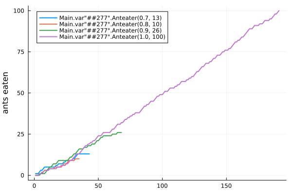

```@meta
EditURL = "notebook.jl"
```

# Anteaters competing for food

> A demonstration of controlling multiple agents using IterationControl.jl

The source for this demonstration can be found
[here](https://github.com/JuliaAI/IterationControl.jl/tree/dev/docs/src/notebooks/eaters/.).

Controlling competing iterative models in parallel is useful in optimization. For
example, one might try several different optimization strategies in parallel, and divert
resources to the strategy or strategies that are performing best.

In this toy illustration, several anteaters of varying health compete for food from a
common supply - a stream of random "ant" or inedible "seed" items. An anteater's
`health` attribute is the probability he is able to successfully catch an ant when the
source makes it available.

If an anteater's score (the number of ants consumed) falls too far behind that of the
leader, he stops consuming (his "training" stops early). An anteater also stops if he
reaches the specified goal.

Anteaters forage for food in parallel using Julia multi-threading.

````@julia
using IterationControl
using .Threads
using Random
Random.seed!(123)
using Plots
````

## Create a channel to supply food

````@julia
N = 1_000_000
food = Channel{String}() do ch
    foreach(i -> put!(ch, rand(["ant", "seed"])), 1:N)
end

[take!(food) for i in 1:3]
````

````
3-element Vector{String}:
 "seed"
 "seed"
 "ant"
````

## Define anteaters and how to "train" them

````@julia
mutable struct Anteater
    health::Float64        # 0.0 = dead; 1.0 = excellent health
    n::Int                 # number of ants consumed
    Anteater(health) = new(health, 0)
end

function eat!(eater::Anteater)
    take!(food) == "ant" && rand() <= eater.health && (eater.n += 1)
    return eater
end;
````

"Training" for `n` iterations means take `n` items from the `food`
 source and try to catch and eat each item if it is an "ant":

````@julia
function IterationControl.train!(eater::Anteater, n::Int)
    foreach(i->eat!(eater), 1:n)
    return eater
end;
````

## Create a collection of competitors

````@julia
eaters = [Anteater(0.7), Anteater(0.8), Anteater(0.9), Anteater(1.0)]
````

````
4-element Vector{Main.var"##277".Anteater}:
 Main.var"##277".Anteater(0.7, 0)
 Main.var"##277".Anteater(0.8, 0)
 Main.var"##277".Anteater(0.9, 0)
 Main.var"##277".Anteater(1.0, 0)
````

````@julia
n_eaters = length(eaters);
````

## Define the controls that will define the rules of the competition

````@julia
const LEAD_TRIGGERING_DEFEAT = 5
const ANTS_TO_WIN = 100

scores(eaters) = [e.n for e in eaters]

is_too_far_behind(eater) =
    maximum(scores(eaters)) - eater.n > LEAD_TRIGGERING_DEFEAT

has_won(eater) = eater.n >= ANTS_TO_WIN

controls = [
    Step(1),
    Callback(is_too_far_behind, stop_if_true=true),
    Callback(has_won, stop_if_true=true),
    Callback(eater->eater.n),
    NumberLimit(1000),
];
````

## Run the competition

````@julia
tasks = [Threads.@spawn IterationControl.train!(e, controls...) for e in eaters]
histories = map(fetch.(tasks)) do traces
    traces[4].called_back
end
````

````
4-element Vector{Vector{Int64}}:
 [1, 1, 1, 2, 3, 3, 4, 5, 5, 5, 5, 5, 5, 5, 5, 5, 6, 6, 7, 7, 7, 7, 8, 8, 9, 9, 9, 9, 9, 10, 10, 11, 12, 13, 13, 13, 13, 13, 13, 13, 13, 13, 13]
 [0, 0, 0, 1, 1, 1, 2, 3, 3, 3, 4, 4, 4, 4, 4, 5, 5, 5, 5, 5, 5, 6, 7, 7, 7, 8, 9, 9, 9, 9, 9, 10, 10, 10, 10]
 [0, 0, 0, 0, 1, 1, 1, 1, 2, 3, 4, 5, 5, 6, 7, 7, 7, 8, 9, 9, 9, 9, 9, 9, 9, 9, 10, 11, 11, 12, 13, 13, 14, 15, 16, 16, 16, 16, 17, 17, 17, 18, 18, 18, 19, 19, 19, 20, 21, 21, 22, 23, 23, 24, 24, 24, 24, 24, 24, 24, 25, 25, 25, 25, 26, 26, 26, 26]
 [0, 0, 0, 1, 1, 2, 2, 3, 3, 3, 3, 4, 4, 4, 4, 4, 4, 5, 5, 5, 6, 6, 6, 6, 7, 7, 8, 9, 9, 10, 11, 12, 13, 13, 13, 14, 15, 16, 17, 18, 18, 19, 19, 20, 20, 21, 21, 22, 23, 24, 24, 24, 25, 26, 26, 26, 26, 26, 26, 27, 28, 28, 29, 30, 31, 31, 31, 32, 32, 33, 34, 34, 35, 35, 36, 36, 37, 37, 38, 38, 38, 38, 39, 40, 41, 42, 42, 43, 43, 44, 45, 45, 45, 46, 47, 48, 48, 49, 49, 49, 50, 51, 51, 51, 52, 53, 53, 53, 53, 54, 54, 55, 55, 56, 57, 57, 57, 57, 58, 58, 59, 59, 60, 60, 61, 62, 63, 63, 64, 65, 66, 66, 67, 68, 68, 68, 69, 69, 70, 71, 71, 72, 73, 73, 73, 74, 75, 75, 76, 76, 76, 77, 77, 78, 79, 80, 81, 81, 82, 82, 83, 84, 84, 85, 86, 87, 88, 89, 89, 89, 90, 91, 91, 91, 91, 92, 92, 92, 93, 94, 94, 94, 94, 95, 95, 96, 97, 98, 98, 99, 100]
````

## Plot the results

````@julia
fig = plot()
for (j, e) in enumerate(eaters)
    plot!(histories[j], label=repr(e), linewidth=2);
end
ylabel!(fig, "ants eaten");
savefig(fig, "anteaters.svg");
````



---

*This page was generated using [Literate.jl](https://github.com/fredrikekre/Literate.jl).*

