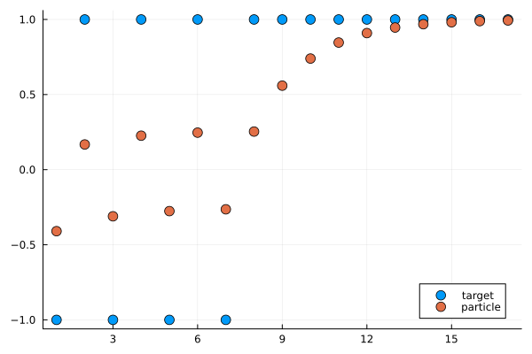
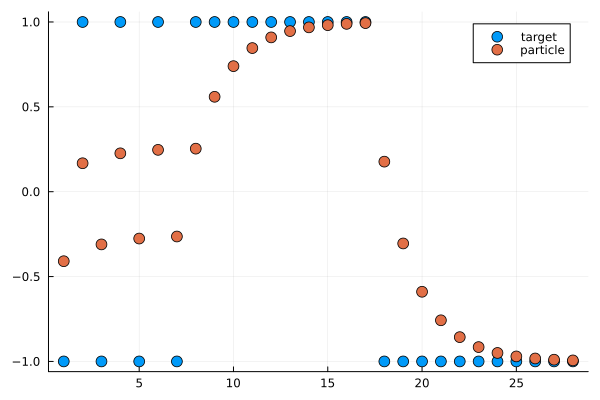

```@meta
EditURL = "notebook.jl"
```

# Controlling A Particle Tracker

> A demonstration of the `Data` control for online training, with callbacks

The source for this demonstration can be found
[here](https://github.com/JuliaAI/IterationControl.jl/tree/dev/docs/src/notebooks/particle/).

````@julia
using Plots
using IterationControl
````

Consider an object that tracks a particle in one dimension, moving
in discrete time at a speed proportional to the distance away from
some moving target. We are viewing this particle as a toy example of
online learning and call the constant of proportionality `η` a
*learning rate*.

The particle is initially at rest at the origin, which is also where
the target begins.

Calling `train!` on the particle moves it along for the specified
number of time steps, while calling `ingest!` updates the target
position ("data ingestion").

````@julia
mutable struct Particle
    position::Float64
    target::Float64
    velocity::Float64
    η::Float64 # learning rate
    Particle(η) = new(0.0, 0.0, 0.0, η)
end

Particle(; η=0.1) = Particle(η)

loss(model::Particle) =  abs(model.target - model.position)
````

````
loss (generic function with 1 method)
````

A method to train for one time step:

````@julia
function train!(model::Particle)
    model.velocity = model.η*(model.target - model.position)
    model.position = model.position + model.velocity
end;
````

And for multiple time steps:

````@julia
function train!(model, n)
    foreach(1:n) do _
        train!(model)
    end
    return nothing
end;
````

A method for updating the target:

````@julia
function ingest!(model::Particle, target)
    model.target = target
    return nothing
end
````

````
ingest! (generic function with 1 method)
````

Lifting the `train!`, `loss` and `ingest!` methods to IterationControl.jl:

````@julia
IterationControl.train!(model::Particle, n::Int) = train!(model, n)
IterationControl.loss(model::Particle) = loss(model)
IterationControl.ingest!(model::Particle, datum) = ingest!(model, datum);
````

Lets `train` our particle by alternatively setting the target position to -1 or +1 every
5 time steps, for a total of 40 time steps (four -1/+1 cycles). We will then then allow
our particle to "cruise" with the target fixed thereafter (the provided `data` iterator
having been exhausted). This cruising is allowed to continue until the particle is
within 0.01 units of the target.

We use a learning rate of 0.1.

````@julia
model = Particle(0.1)
data = repeat([-1, 1], outer=4)
````

````
8-element Vector{Int64}:
 -1
  1
 -1
  1
 -1
  1
 -1
  1
````

````@julia
traces = IterationControl.train!(
    model,
    Data(data),
    Step(5),
    Callback(model->model.target),
    Callback(model->model.position),
    Threshold(0.01),
    TimeLimit(0.005),
)
````

````
6-element Vector{Any}:
 ControlTrace{<:Data}
 ControlTrace{<:Step}, ending (new_iterations = 85, new_steps = 17)
 ControlTrace{<:Callback}, ending (called_back = 1.0,)
 ControlTrace{<:Callback}, ending (called_back = 0.9934860451342596,)
 ControlTrace{<:Threshold}, ending (loss = 0.006513954865740357, excess = -0.0034860451342596434)
 ControlTrace{<:TimeLimit}, ending (time = Dates.DateTime("2026-10-19T08:49:38.334"),)
````

````@julia
target_positions = traces[3].called_back
particle_positions = traces[4].called_back
fig = scatter(target_positions, label="target", ms=6);
scatter!(fig, particle_positions, label="particle", ms=6);
savefig(fig, "particle.svg");
````



````@julia
losses = traces[5].loss
````

````
17-element Vector{Float64}:
 0.59049
 0.8323015599
 0.689514251894649
 0.7738287293987287
 0.7240418735773446
 0.7534405140713137
 0.7360809108460299
 0.7463315829545278
 0.44070133641881915
 0.26022973214194844
 0.15366305453249895
 0.09073649707089537
 0.05357899415539302
 0.031637860258817985
 0.018681840104229352
 0.011031439763146467
 0.006513954865740357
````

Switching the target just once more to the -1 position and
continuing training until the particle and target are withing 0.01:

````@julia
data = [-1,]

traces = IterationControl.train!(
    model,
    Data(data),
    Step(5),
    Callback(model->model.target),
    Callback(model->model.position),
    Threshold(0.01),
    TimeLimit(0.005)
)
append!(target_positions, traces[3].called_back)
append!(particle_positions,traces[4].called_back)
fig = scatter(target_positions, label="target", ms=6);
scatter!(fig, particle_positions, label="particle", ms=6);
savefig(fig, "particle2.svg");
````

````
[ Info: final loss: 0.006066681833463705
[ Info: Stop triggered by EarlyStopping.Threshold(0.01) stopping criterion. 

````



---

*This page was generated using [Literate.jl](https://github.com/fredrikekre/Literate.jl).*

